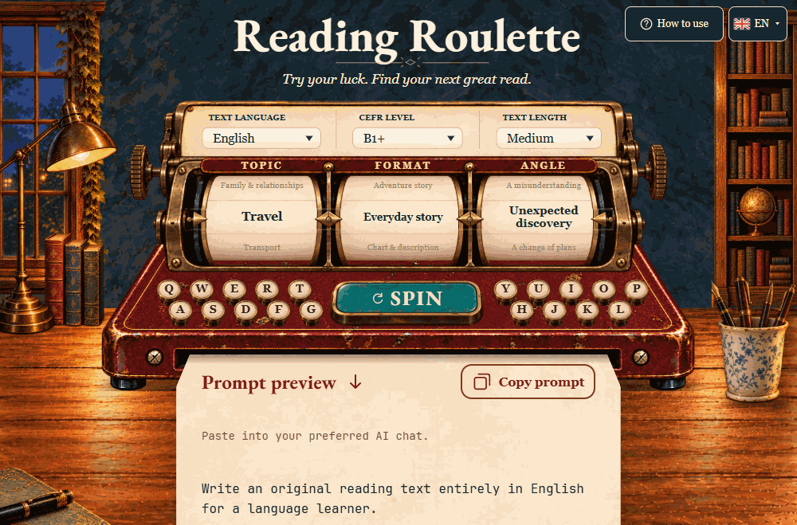
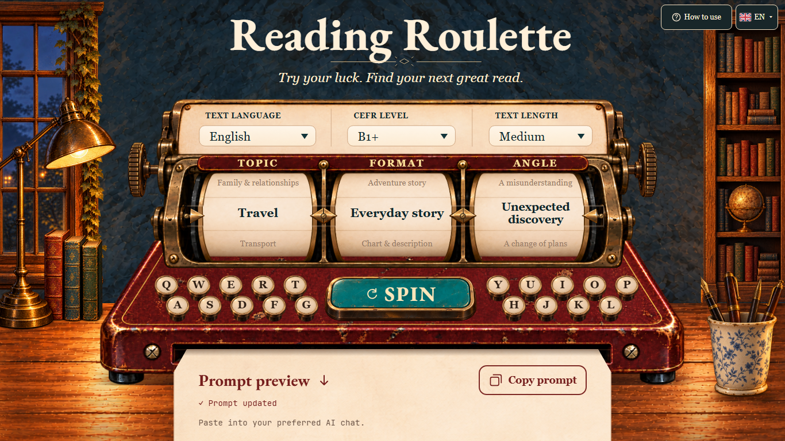
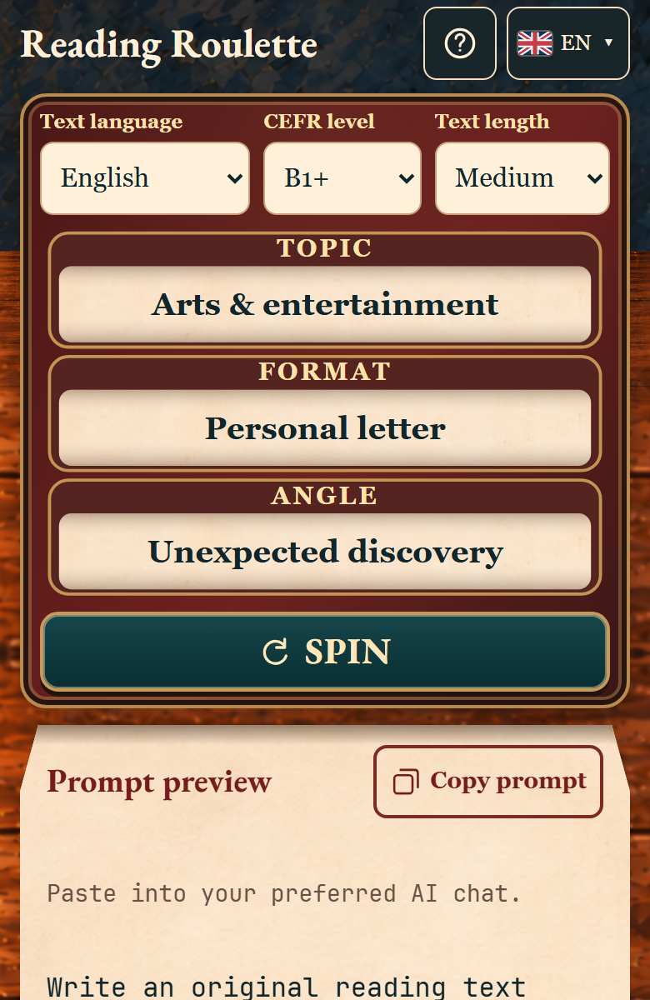

# Reading Roulette

> Turn “What should I read next?” into an idea matched to your language, level, and preferred reading length.

**Reading Roulette** is a playful prompt builder for independent language learners. One spin combines a topic, a recognizable text format, and a specific angle. Set the target language, CEFR level, and length, then copy a ready-to-use prompt into ChatGPT, Claude, Gemini, or another AI chat.

[**Open the live app**](https://iaroslav-tkachenko.github.io/reading-roulette/) · [Product and architecture notes](PROJECT.md) · [Deployment record](docs/DEPLOYMENT.md)



Three spins produce different **Topic × Format × Angle** ideas. The learner can change the reading language and level between spins, then copy the finished prompt into a preferred AI chat.

## The product

Reading practice is easy to postpone when choosing what to read takes longer than getting started. Reading Roulette makes that first choice quick and repeatable: it offers a fresh, structured reading idea without asking learners to browse a long list or invent a prompt from scratch.

It is designed for **self-directed learners** who want extra reading in a language they are studying. The selected settings guide the outside AI chat toward an appropriate subject, format, level, and amount of text. The chat creates the reading material; Reading Roulette prepares the request and does not grade or fact-check the generated result.

| The catalog | Learner controls | The output |
| --- | --- | --- |
| **4,310** unique Topic × Format × Angle ideas | **11** reading languages | A copy-ready prompt |
| **26** topics · **44** formats · **30** angles | **15** CEFR-tuned choices | A requested reading plus useful vocabulary |
| **6** weighted reading families | Short · Medium · Long | Works with the learner’s preferred AI chat |

The plus/minus settings tune difficulty around the six standard CEFR bands; they are not additional official CEFR levels.

The 4,310 ideas are the unique triples available across the catalog. The app filters them by level, length, and explicit compatibility rules; it does not treat every possible cross-product as valid.

## Screenshots

### Desktop



### Mobile



## How a spin becomes a reading prompt

1. **Set the practice context.** Choose the language for the reading, a CEFR-tuned level, and Short, Medium, or Long.
2. **Spin for a compatible idea.** The result combines **Topic × Format × Angle**. Eligibility rules account for content depth, format, length, and meaning. Available reading families are selected using their approved weights, so catalog size alone does not skew the mix.
3. **Review and copy the prompt.** The preview explains the requested content, volume, and any relevant source or training-data requirements. Copy the full prompt into an AI chat of your choice.
4. **Read and learn.** Prompts request a final useful-vocabulary section alongside the reading. Check factual claims and adapt the result to your needs in the external chat.

Changing a setting keeps the current idea when it remains valid and updates its prompt. If the idea no longer fits, the app clears it and asks for a new spin. The result shown on screen and the copied prompt always refer to the same combination.

## Examples of reading ideas

| Topic | Format | Angle | What the prompt is for |
| --- | --- | --- | --- |
| Travel | Everyday story | Unexpected discovery | A fictional, level-aware story built around a small discovery during a trip. |
| City | News brief | What changed | A concise update based on real, found sources, with attribution requested. |
| Personal finance | Chart | Noticeable pattern | A learning example with clearly labelled practice data and a cautious explanation. |

These examples show why the third choice matters: it gives the reading a concrete idea, while the format defines how that idea is presented. Fictional, training, factual, and sourced prompts follow different instructions. Those instructions guide the external model; they are not a verification of its answer.

## Product decisions behind the experience

- **Useful variety, with guardrails.** Topic, format, and angle are screened together against the learner’s level and selected length. The interface does not offer a combination just because each label works on its own.
- **Balanced discovery.** Six weighted reading families include stories, practical texts, and visual reading. The family weights are normalized after unavailable options are filtered out.
- **Difficulty and volume stay distinct.** CEFR-tuned settings guide language and content depth; the length setting guides the amount or structure of material. Japanese and Mandarin use relative-length guidance instead of unsupported word-count targets.
- **Learners keep control.** Prompts are built locally in the browser. There is no account, backend, model API, or provider lock-in. The learner chooses where to use the prompt and reviews the result there.
- **The interface supports different ways of using it.** The UI and prompt instructions are available in English and Russian, independently of the 11 reading languages. SPIN and Copy support keyboard use, visible focus, and reduced-motion preferences.

## Technical overview

Reading Roulette is a static React and TypeScript application built with Vite. Catalog data, eligibility rules, random selection, and prompt composition live in separate modules. GitHub Actions builds and deploys the static site to GitHub Pages.

The application does not call an AI model. Prompts can be used with ChatGPT, Claude, Gemini, or another chat, but the generated text’s accuracy, CEFR level, length, and quality are not guaranteed by this app.

### Run locally

Prerequisites: Node.js 22.12+ and pnpm 10.22.0.

```sh
pnpm install --frozen-lockfile
pnpm dev
```

For a GitHub Pages production build:

```sh
pnpm typecheck
pnpm build --base=/reading-roulette/
```

## Documentation

- [Project architecture and product contract](PROJECT.md)
- [Catalog principles](docs/CATALOGS.md): [topics](docs/TOPICS.md), [formats](docs/FORMATS.md), and [angles](docs/ANGLES.md)
- [Reading-family balance](docs/READING_FAMILIES.md), [levels and length](docs/LEVELS_LENGTH.md), [content status](docs/CONTENT_STATUS.md), and [reading languages](docs/LANGUAGES.md)
- [Catalog and runtime validation](docs/CATALOG_VALIDATION.md)
- [Current deployment and verification record](docs/DEPLOYMENT.md)
- [Interface and motion implementation report](docs/design/implementation-step11-v10/README.md) and [English/Russian localization report](docs/localization/IMPLEMENTATION.md)
