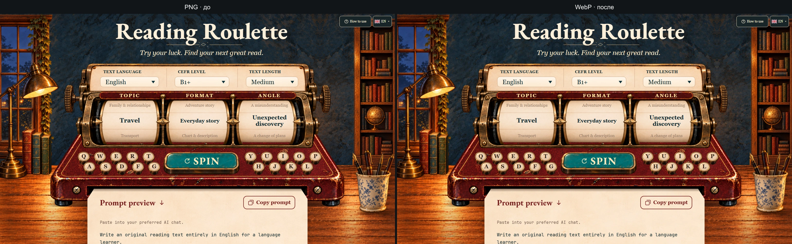
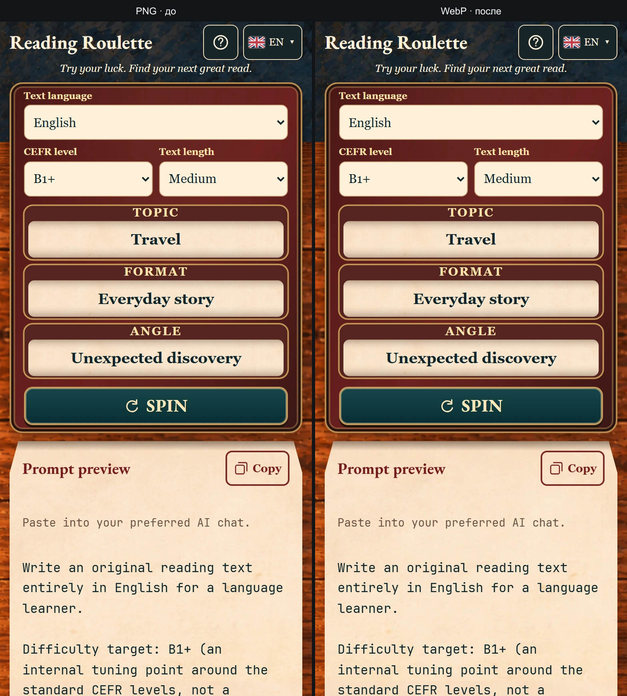

# Оптимизация графики

Дата: 2026-10-12. Исходные 14 PNG сохранены без изменений. Приложение использует WebP-производные из `src/assets/reading-machine/optimized/`; desktop-слои комнаты в compact-раскладке переключаются на пять меньших вариантов. PNG больше не входят в production-сборку.

## Формат и разрешение

Использован libwebp 1.6.0 через Sharp 0.35.4: quality 92, alphaQuality 100, effort 4. Уменьшение выполнено Lanczos 3. Размеры выбраны из вложенных SVG `viewBox` и размеров слоёв: верхняя граница desktop — 1536 CSS px при 2×, граница compact — 900 CSS px при 2×. Paper, room shell и машинные слои, которым для этого предела уже нужна исходная плотность, оставлены в исходных пикселях. Исходные PNG остаются рядом с производными.

| Слой | PNG, px | Desktop WebP, px | Размер WebP |
| --- | ---: | ---: | ---: |
| Bookcase | 988×1592 | 796×1282 | 422 208 B |
| Desk books | 1536×1024 | 1490×993 | 435 334 B |
| Desk lamp/books | 930×1692 | 568×1033 | 146 390 B |
| Pen cup | 1024×1536 | 392×588 | 78 770 B |
| Drum | 1429×1100 | 652×502 | 31 596 B |
| Key | 1261×1247 | 129×128 | 6 110 B |
| Spin button | 2140×735 | 651×224 | 48 750 B |
| Window | 972×1619 | 740×1232 | 351 468 B |
| Wheel | 971×1619 | 161×269 | 14 670 B |
| Chassis | 2100×749 | 2100×749 | 348 056 B |
| Mechanism | 2157×729 | 2157×729 | 178 770 B |
| Paper | 2132×738 | 2132×738 | 198 768 B |
| Settings | 2172×724 | 2172×724 | 127 236 B |
| Room shell | 1584×993 | 1584×993 | 400 228 B |

Desktop derivatives total **2,788,354 B** versus **24,075,123 B** for the source PNGs, an 88.4% reduction. The five compact room variants add 549,220 B; all 19 WebP files total 3,337,574 B. Compact files target the largest viewport that selects them, so a 390 px phone does not fetch desktop-size window, bookcase, books, lamp or cup artwork.

## Холодная загрузка

Production-сборки сравнивались в headless Chromium 153.0.8010.12 через локальный production preview с `/reading-roulette/`. Для каждого профиля выполнено три загрузки, каждый раз в новом BrowserContext с `Network.setCacheDisabled=true`.

| Профиль | Изображения до → после | Весь transfer до → после |
| --- | ---: | ---: |
| Desktop, 1536×900, DPR 1 | 24.08 → 2.79 MB (−88.4%) | 24.37 → 3.09 MB (−87.3%) |
| Mobile, 390×844, DPR 2 | 14.60 → 1.15 MB (−92.1%) | 14.90 → 1.44 MB (−90.3%) |

Это байты первого запроса по Navigation/Resource Timing: transfer HTML-документа плюс всех subresources, включая локальные HTTP-заголовки. Preview не моделирует задержки реальной сети и серверное сжатие, поэтому время FCP сохранено в JSON-замерах, но не используется как обещание ускорения на конкретном подключении. На desktop загружено 14 изображений, на mobile — 7. Все WebP получили HTTP 200 с `image/webp`; ошибок запросов, MIME и консоли нет.

## Визуальная проверка

Снимки сняты в одинаковых размерах при фиксированной начальной комбинации. Сравнены вся desktop-сцена, компактная mobile-сцена, бумага, мелкий рисунок клавиш/колёс и прозрачные края предметов на фоне комнаты. WebP-декодер сохранил альфа-значения пиксель в пиксель для всех 19 вариантов относительно соответствующих исходников, уменьшенных тем же фильтром. На скриншотах геометрия и края совпадают; бумажная фактура и мелкие детали визуально сохранены.

[Крупный план бумаги на desktop](paper-desktop-comparison.webp) · [бумага на mobile](paper-mobile-comparison.webp)

Физический телефон и Safari не проверялись; mobile-снимок сделан в Chromium при 390 CSS px и DPR 2.

## Проверки и повторный запуск

- `node_modules/typescript/bin/tsc -b` — успешно.
- `vite build --base=/reading-roulette/` — успешно. Суммарный размер `dist`: 24,730,082 → 3,993,128 B. В production output PNG нет.
- Все 19 WebP сверены с PNG при композитинге на тёмный и бумажный фоны; отчёт и альфа-проверка: [artwork-fidelity.json](artwork-fidelity.json).
- Холодные измерения: [до](before/baseline-first-load.json) и [после](after/optimized-first-load.json). [Сравнение скриншотов](visual-comparison.json).

Для повторной генерации нужен Sharp 0.35.4. `READING_SHARP_MODULE` можно задать путём к установленному пакету `sharp`; добавлять Sharp в зависимости сайта не требуется. Сборка и замер выполняются в production preview. `prepare-optimized-artwork.mjs`, `verify-artwork-fidelity.mjs`, `measure-first-load.mjs` и `create-visual-comparisons.mjs` сохраняют команды и параметры этапа.
